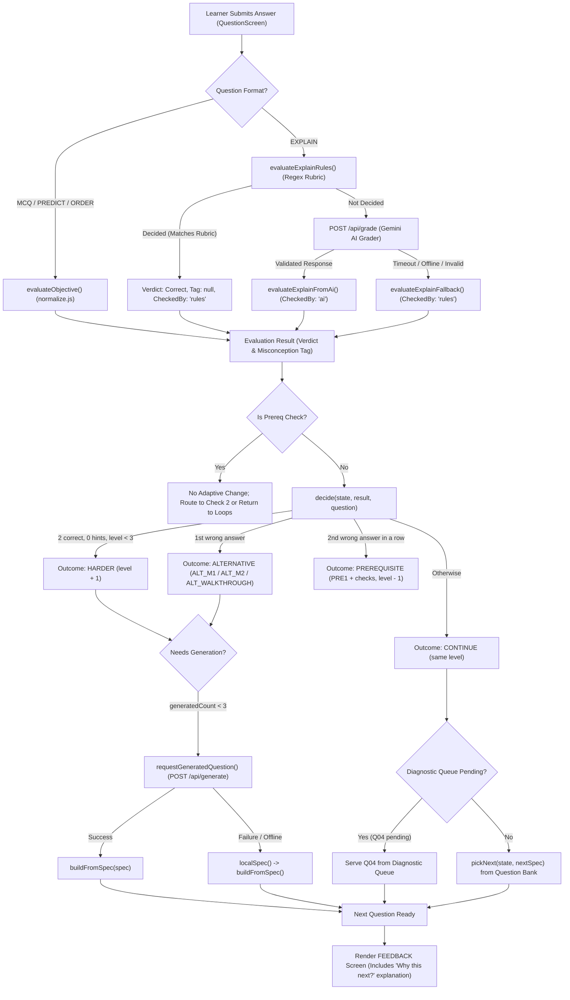

# Architecture & System Design — Loop Coach

> **Card:** `P4-T10-L5-C4` · **Roll No:** `23b2505`  
> **Topic:** Loops in block or Python programming (Class 8–11)  
> **Learner:** Anxious repeat learner (L5) · **Constraint:** 10-minute sessions with stop and resume (C4)

---

## 1. File Tree & Component Map

```
et617-endsem-23b2505/
├── DESIGN.md                      # Educational problem, persona, learning outcomes, content plan
├── IMPLEMENTATION_SPEC.md         # Single source of truth specifications
├── README.md                      # Setup instructions, local run commands, Vercel deployment guide
├── CHAT_HISTORY.txt               # End-to-end conversation transcript log
├── package.json                   # React 18, Vite 5, @vitejs/plugin-react
├── vite.config.js                 # Vite build and plugin config
├── index.html                     # Viewport meta, title "Loop Coach", root DOM mounting point
├── api/                           # Vercel Serverless Functions
│   ├── _gemini.js                 # Shared REST client for Google Gemini API with timeout control
│   ├── grade.js                   # POST /api/grade — Generative AI explanation grader
│   └── generate.js                # POST /api/generate — Generative AI parameter suggester
├── src/
│   ├── main.jsx                   # Entry point mounting App into #root
│   ├── App.jsx                    # Root state coordinator, timer, event handlers, screen router
│   ├── config.js                  # Fixed system constants (Roll No: 23b2505, Card, timeouts)
│   ├── styles.css                 # Custom CSS variables, mobile-first responsive layout, accessible focus
│   ├── state/
│   │   ├── reducer.js             # Pure reducer managing screens, streaks, questions, and decisions
│   │   └── storage.js             # Safe localStorage persistence (loadState, saveState, clearState)
│   ├── lib/
│   │   ├── normalize.js           # String normalization (lowercasing, punctuation stripping)
│   │   ├── evaluate.js            # Objective & explain evaluation; tag assignment (M1, M2, GENERIC)
│   │   ├── decide.js              # Adaptive decision engine (HARDER, ALTERNATIVE, PREREQUISITE, CONTINUE)
│   │   ├── pickNext.js            # Question selector matching difficulty level, tags, and format variety
│   │   ├── generator.js           # Parametric question builder and deterministic answer computer
│   │   ├── skills.js              # Skill competency status evaluator (Got it, Getting there, Revisit)
│   │   ├── aiClient.js            # Client-side API caller with strict response validators & fallbacks
│   │   └── log.js                 # Event logger persisting timestamped telemetry to localStorage
│   ├── data/
│   │   ├── questions.js           # 14 curated questions across 4 formats + 2 prerequisite checks
│   │   ├── lessons.js             # Multi-modal mini-lessons (ALT_M1, ALT_M2, ALT_WALKTHROUGH, PRE1)
│   │   └── copy.js                # Shared empathetic UI text and promises
│   └── components/
│       ├── Footer.jsx             # Persistent identity footer: ET 617 · Roll No: 23b2505 · Card P4-T10-L5-C4
│       ├── TimerChip.jsx          # Active countdown chip (⏱ m:ss left / ⏱ Time is up)
│       ├── CodeBlock.jsx          # Accessible monospace code container
│       ├── Welcome.jsx            # Landing screen with Start, Continue where I stopped, and Promises
│       ├── Intro.jsx              # 3 micro-concept introductory cards
│       ├── QuestionScreen.jsx     # Active question host for MCQ, PREDICT, ORDER, and EXPLAIN
│       ├── Mcq.jsx                # Multiple choice component with letter badge and select checkmark
│       ├── Predict.jsx            # Monospace single-line output prediction input
│       ├── Order.jsx              # Two-zone tap-to-move line ordering preserving indentation
│       ├── Explain.jsx            # Free-text explanation input with live 300-char counter
│       ├── Feedback.jsx           # Amber/Green feedback screen, model answer, and "Why this next?"
│       ├── Lesson.jsx             # Mini-lesson viewer for alternative and prerequisite explanations
│       ├── Summary.jsx            # End-of-session qualitative skills summary and next focus
│       └── About.jsx              # Educational rationale, decision rules, and JSON log export
└── docs/
    ├── ARCHITECTURE.md            # This system architecture specification
    └── DECISIONS.md               # Architectural & pedagogical decision records
```

---

## 2. State Machine & Schema

The application is governed by a predictable, deterministic state machine (`src/state/reducer.js`):

```js
const state = {
  version: 1,
  screen: "WELCOME",          // WELCOME | INTRO | QUESTION | FEEDBACK | LESSON | SUMMARY | ABOUT
  prevScreen: "WELCOME",      // Tracks previous screen for ABOUT back-navigation
  remainingSeconds: 600,      // 10-minute active session countdown (Constraint C4)
  timeUp: false,              // Set true when remainingSeconds reaches 0
  level: 1,                   // Current adaptive difficulty level (1..3)
  correctStreak: 0,           // Consecutive correct answers
  wrongStreak: 0,             // Consecutive wrong answers (triggers PRE1 at 2)
  recentNoHintCorrect: 0,     // Consecutive correct answers with 0 hints (triggers HARDER at 2)
  answeredCount: 0,           // Total scored questions completed (max 8)
  generatedCount: 0,          // Count of AI/dynamically generated questions served
  seenIds: [],                // IDs of questions already completed this session
  diagnosticQueue: ["Q03","Q04"], // First two diagnostic questions
  lastFormat: null,           // Previous question format (used to ensure format variety)
  generatedKeys: [],          // JSON string keys of generated params to prevent repetition
  current: {                  // Active question context
    question: {...},
    startedAtMs: 1731935000000,
    hintsUsed: 0,
    isPrereqCheck: false
  },
  feedback: {                 // Feedback for the submitted answer
    verdict: "correct" | "wrong",
    tag: null | "M1" | "M2" | "GENERIC",
    feedbackText: "...",
    answerText: "...",
    checkedBy: "rules" | "ai",
    decision: {...}
  },
  lesson: null,               // Active lesson object for LESSON screen
  prereq: { active: false, step: 0 }, // Prerequisite flow tracking (step 0=lesson, 1=check 1, 2=check 2)
  nextQuestion: null,         // Pre-computed next question
  results: []                 // Full array of question results for telemetry and skills evaluation
};
```

---

## 3. Data Flow: Answer → Evaluate → Decide → Pick Next



---

## 4. AI Endpoints & Dual Fallback Architecture

### Endpoint 1: Free-Text Grader (`api/grade.js`)
- **Protocol:** `POST /api/grade`
- **Request:** `{ prompt, code, rubric, modelAnswer, studentAnswer }`
- **System Prompt:** Instructs Gemini 2.5 Flash to act as a warm, supportive tutor for an anxious 15-year-old student, providing a JSON verdict (`correct`, `partial`, `incorrect`), diagnosed misconception (`M1`, `M2`, `null`), and a kind nudge (`hint` <= 200 chars).
- **Client-Side Validation (`validateGrade`):**
  - Asserts verdict and misconception tags are valid.
  - Ensures hint is pure printable ASCII and does not leak the model answer.
  - Strictly rejects any negative words (`wrong`, `incorrect`, `stupid`, `silly`, `fail`).
- **Graceful Fallback:** If the API times out (8,000ms), errors, or fails validation, `evaluateExplainFallback` runs deterministic regexes and displays `Checked with built-in rules (AI helper not available right now)`.

### Endpoint 2: Parameter Suggester (`api/generate.js`)
- **Protocol:** `POST /api/generate`
- **Request:** `{ level, targetTag, recent }`
- **System Prompt:** Instructs Gemini to select parameters for two proven templates:
  1. `range_values`: `{ start, stop, step }`
  2. `after_loop`: `{ n, word, after }`
- **Client-Side Validation (`buildFromSpec`):**
  - Validates all numbers against explicit level grids.
  - Computes exact ground truth and misconception answers (M1/M2) deterministically in JavaScript.
  - The AI **never computes code execution outputs**.
- **Graceful Fallback:** If offline or timed out (6,000ms), `localSpec` generates random valid parameters satisfying the requested level and misconception target.

---

## 5. Constraint C4 Architecture (10-Minute Sessions with Pause & Resume)

1. **Active Time Counting:**
   - The countdown timer runs on a 1-second interval attached only while `state.screen` is `QUESTION`, `FEEDBACK`, or `LESSON`.
   - Timer stops when the document is hidden (`document.visibilityState !== "visible"`), ensuring learners are not penalized for switching tabs.
   - Time spent on `WELCOME` and `ABOUT` is excluded from the 10 minutes.

2. **Full State Persistence (`localStorage`):**
   - Serialized on every state change during an active session using key `et617_state_v1`.
   - Tapping "Stop for now" transitions the learner to `WELCOME` with state securely saved.
   - On returning to the app, `Welcome.jsx` detects the unfinished session and displays `Continue where I stopped (Question X of 8 · m:ss left)`.
   - "Start fresh" resets state cleanly.

3. **Gentle Time-Up Handling:**
   - When `remainingSeconds <= 0`, `timeUp` becomes `true`.
   - An amber notice appears: `"10 minutes are up. Let's finish this question, then we'll wrap up."`
   - The learner is never abruptly interrupted; upon checking their current question, the feedback screen smoothly routes them to `SUMMARY`.
